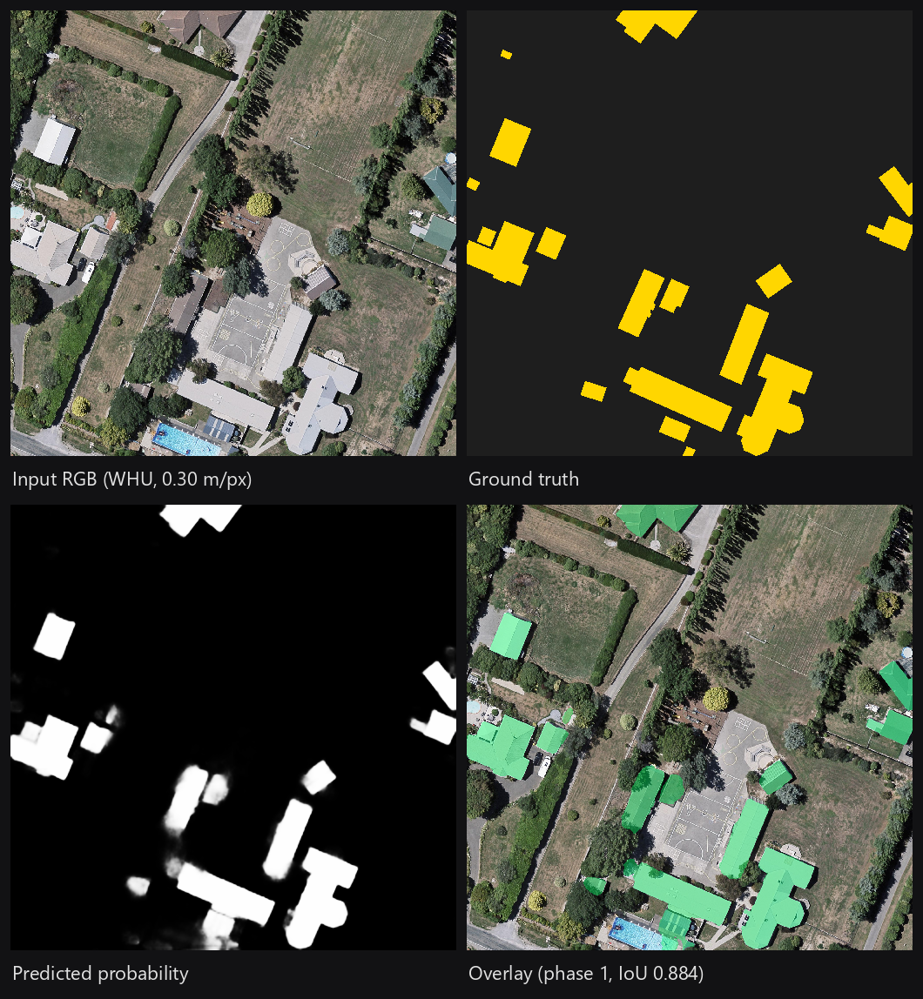
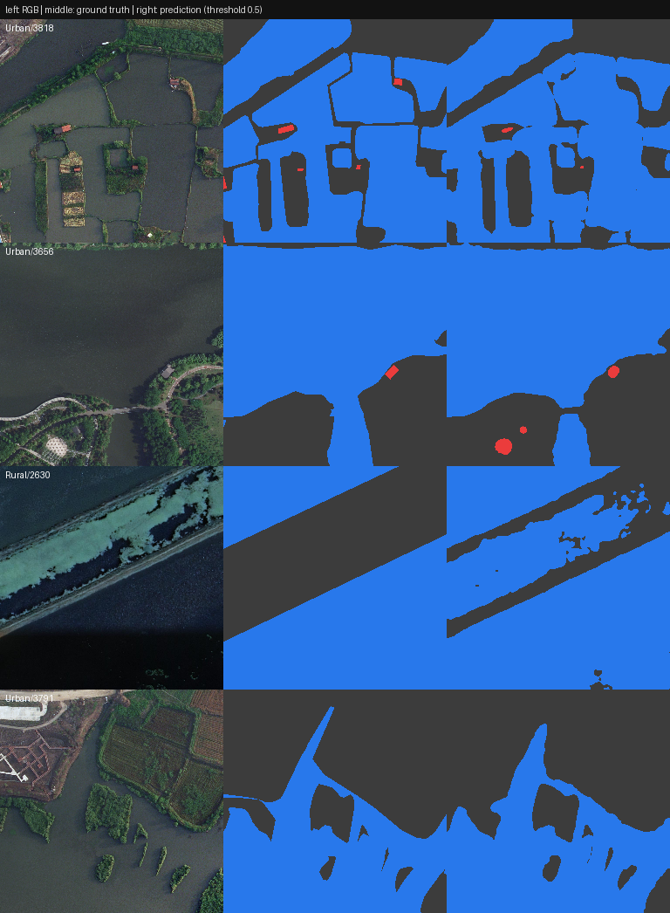

# Aerial & Satellite Segmentation — buildings, water, and shadow-derived height

Semantic segmentation of aerial and satellite imagery with PyTorch, plus a
local upload app that reports per-building areas, footprints and a
shadow-based height estimate.

**0.884 test IoU** for building extraction on the WHU dataset, and a two-head
model that segments **buildings and water together** at **0.706 water IoU** on
LoveDA. Everything runs locally; no images leave the machine.



---

## What it does

| Capability | Status |
|---|---|
| Building segmentation | **0.8841 test IoU**, 0.9385 F1 (phase 1, ResNet34 U-Net) |
| Water segmentation | **0.7064 IoU** on LoveDA (phase 5, two-head) |
| Metric areas (m²) | per-building footprints at a stated ground sample distance |
| Building height & volume | shadow geometry — estimated, and refused when no shadow exists |
| Upload app | drag-and-drop, overlay + mask + probability + `summary.csv` |
| Tiled inference | 512 px windows with Hann blending, arbitrary image size |

---

## Results

### Buildings — WHU Building Dataset

Measured on the held-out test split (2 416 tiles), threshold 0.5, same protocol
for every row.

| Phase | Model | Test IoU | Test F1 | Note |
|---|---|---|---|---|
| **1** | ResNet34 U-Net | **0.8841** | 0.9385 | production model used by the app |
| 2 | SatMAE++ ViT + CNN decoder | 0.7282 | 0.8428 | encoder position table was zeroed by a bug |
| 3 | SatMAE++ ViT + Swin decoder | 0.7967 | 0.8868 | same bug, ~50 epochs |
| 3 | SatMAE++ ViT + Swin, **bug fixed** | 0.7291 | 0.8433 | only 5 epochs — see the engineering notes |
| 4 | Phase 3 + SAM pseudo-labels | 0.7686 | 0.8692 | pseudo-labels were poor quality |

### Water — LoveDA

A **different dataset and sensor** (0.3 m RGB), so these numbers are not
comparable with the WHU figures above and are never presented as such.

Scored by `tools/eval_phase5.py` on full 1024×1024 tiles: 62 of 1 669 validation
tiles (every 27th, unfiltered — no cherry-picking tiles that contain water),
10 050 704 valid pixels, threshold 0.5, the same tiled inference the app uses.

| Run | Head | IoU | Precision | Recall | F1 |
|---|---|---|---|---|---|
| 5 epochs | Building | 0.5944 | 0.7567 | 0.7348 | 0.7456 |
| 5 epochs | Water | 0.7023 | 0.8638 | 0.7898 | 0.8251 |
| **20 epochs** | **Building** | **0.6597** | 0.7418 | 0.8562 | 0.7949 |
| **20 epochs** | **Water** | **0.7064** | 0.8635 | 0.7952 | 0.8279 |



The last 15 epochs bought **+0.065 building IoU but only +0.004 water** — water
is 7.4 % of pixels and had already converged, while buildings at 2.7 % kept
improving. Building recall rose 0.735 → 0.856 as precision slipped 0.757 → 0.742:
it finds more buildings and accepts slightly more false positives.

---

## Quick start

### Upload app

Windows — double-click `start_app.bat`. Everything else:

```bash
python app/server.py --port 7860        # auto-selects CUDA when available
python app/server.py --device cpu       # leave the GPU free
```

Open `http://127.0.0.1:7860`, drop in imagery, press **Segment images**. Outputs
land in `outputs/<timestamp>/`.

Set the **ground sample distance** (m/pixel) to get m² areas and heights — 0.30
for both WHU and LoveDA. Without it the app reports pixel counts only, rather
than inventing an area.

### Command line

```bash
python predict.py --phase 1 --input photo.tif --output results/ --overlay
python predict.py --phase 5 --input tiles/ --output results/ --device cpu
```

Phase 1–4 write `{stem}_mask.png`, `{stem}_prob.png`, `{stem}_overlay.png`.
Phase 5 is two-head and writes one set per class,
`{stem}_building_mask.png` and `{stem}_water_mask.png`.

### Install

```bash
python -m venv .venv && source .venv/bin/activate     # Windows: .venv\Scripts\activate
pip install -r requirements.txt -r requirements.lock.txt
```

The models need a 512×512 input; `rs_core.inference` handles tiling, padding and
seam blending, so images of any size work.

---

## How it works

```
image (any size)
      │
      ▼
rs_core.inference — 512 px windows, 64 px overlap, Hann-weighted blending
      │
      ▼
phase 1: ResNet34 U-Net           → 1 head  (building)
phase 5: ResNet34 U-Net           → 2 heads (building, water)
      │
      ▼
rs_core.postprocess — threshold, cleanup, connected components,
                      per-instance area / perimeter / centroid
      │
      ├── overlay + mask + probability PNGs
      ├── summary.csv
      └── rs_core.height — shadow length × GSD × tan(sun elevation)
```

Phase 5 uses **independent binary heads rather than a 3-class softmax**, because
the datasets disagree: WHU labels only buildings, LoveDA labels seven classes.
Two sigmoids let one model serve both without pretending the label spaces match.

---

## Engineering notes — four bugs found by measuring

These are kept in the repo because the measurements are the interesting part.

**1. The ViT position table was being deleted, not resampled.** Phases 2–4
dropped `pos_embed` on a shape mismatch instead of interpolating it, so the
encoder was position-blind. A linear probe on frozen features quantifies it:
**0.5467 IoU broken vs 0.6771 fixed** (`tools/probe_linear.py`). The fix is
verified in the checkpoint (position table sum 586 968, not zero).

The retrained phase 3 scores **0.7291**, *below* the broken 50-epoch model's
0.7967. That is a training-budget difference, not evidence the fix hurt, and it
is not claimed as an improvement until the remaining 46 epochs are trained and
re-scored with `tools/eval_whu_test.py`. Old checkpoints stay in place as
measurements of the broken setup, and the app labels them `[DEGRADED]`.

**2. The ground sample distance was wrong by 4×.** Every area used 0.075 m/px
against WHU's actual **0.30 m/px**, making all reported areas 16× too small:

| Measurement | at 0.075 m/px | at 0.30 m/px |
|---|---|---|
| Median footprint (47 086 test components) | 5.1 m² | **81 m²** |
| Largest pool, tile 106 (54×35 px) | 4.0 × 2.6 m | **16.2 × 10.5 m** |

A 5 m² building does not exist. A wrong GSD rescales every number silently, so
it now lives in `configs/config.yaml` and the app states it explicitly.

**3. The water head was training on roads.** LoveDA's raw ids are
`0 ignore, 1 background, 2 building, 3 road, 4 water, 5 barren, 6 forest,
7 agricultural` — the original mapping had `water: 3`. `verify_mapping()`
(`tools/check_loveda.py`) now aborts training with exit code 2 if the
colour→class mapping stops matching the pixels.

**4. Shadow heights refuse rather than guess.** Height comes from
`shadow_length_px × GSD × tan(sun elevation)`, with solar position from a
timestamp and coordinates (NOAA algorithm, no dependencies). Synthetic scenes of
known height are recovered to 0–2 % error, and the solar model matches published
values (London solstice 61.95° vs 61.9° expected). When imagery has no usable
cast shadow — tile 106 measures a contrast of 0.82 against a 0.78 gate — the app
declines and prints the measured reason instead of returning a plausible number.

---

## Datasets and licensing

The code here is MIT. **The datasets are not**, and neither are the pretrained
encoders:

| Asset | Constraint |
|---|---|
| WHU Building Dataset | research use only |
| LoveDA | non-commercial use |
| SatMAE++ weights | research use only |

That means **the trained checkpoints are not redistributable for commercial use**
and this repo is not a commercial product. Download the datasets yourself:
[WHU](http://gpcv.whu.edu.cn/data/building_dataset.html) ·
[LoveDA](https://zenodo.org/records/5706578). Neither is committed here, and
`checkpoints/`, `runs/`, `data/` and `outputs/` are all gitignored.

---

## Repository layout

```
app/            upload UI + HTTP server (standard library only)
rs_core/        shared inference: model discovery, tiling, postprocess, height
phase1_baseline/    ResNet34 U-Net
phase2_satmae/      SatMAE++ encoder wrapper
phase3_swin_unet/   Swin-Unet decoder
phase4_sam_pseudolabel/  SAM pseudo-labelling pipeline
phase5_multihead/   two-head dataset + LoveDA label mapping
utils/          dataset loading, metrics, losses
tools/          evaluation, probes, and the self-test suite
configs/        all hyperparameters and paths
train.py        single-head training (phases 1-4)
train_multihead.py  two-head training (phase 5)
predict.py      command-line inference
```

---

## Training and evaluation

```bash
python train.py --phase 1                              # building baseline
python train_multihead.py --epochs 20 --tag phase5     # buildings + water

python train.py --phase 3 --resume runs/phase3_fixed/best.pth --epochs 50
python tools/eval_whu_test.py --phase 3 --checkpoint runs/phase3_fixed/best.pth
python tools/eval_phase5.py --limit 60
```

`--epochs` sizes the cosine schedule, `--tag` names the run under `runs/<tag>/`,
`--set KEY=VALUE` overrides config entries, and `--resume` restores weights and
optimizer state and warm-restarts the schedule.

### Self-tests

Each of these guards something that would otherwise waste hours of GPU time:

```bash
python tools/verify_saved_state.py   # checkpoint integrity + strict model load
python tools/check_loveda.py         # dataset pairing, ids, split counts
python tools/test_resume.py          # schedule and resume arithmetic
python tools/test_height.py          # solar position and shadow geometry
python tools/smoke_app.py            # app end-to-end on CPU
```

---

## Scope and limitations

- **Buildings** are the strong result (0.884 IoU). Phase 5's building head is
  weaker (0.6597) and exists to share an encoder with water, not to replace it.
- **Water** is usable but visibly rough at tile edges, and dark deep-water is
  over-segmented. Precision 0.86 / recall 0.80 means it errs toward missing
  water rather than inventing it.
- **Height** assumes flat ground, near-nadir north-up imagery, and a shadow cast
  on open ground rather than onto another building. One height per building,
  regardless of roof shape.
- **Underground depth is not recoverable** from aerial imagery at all. "How deep"
  in the app means height above ground plus volume, not depth below it.
- Phases 2–4 are retained as evidence of a diagnosed bug, not as recommended
  models.

## License

MIT — see [LICENSE](LICENSE). Dataset and pretrained-weight terms are separate
and more restrictive; see above.
